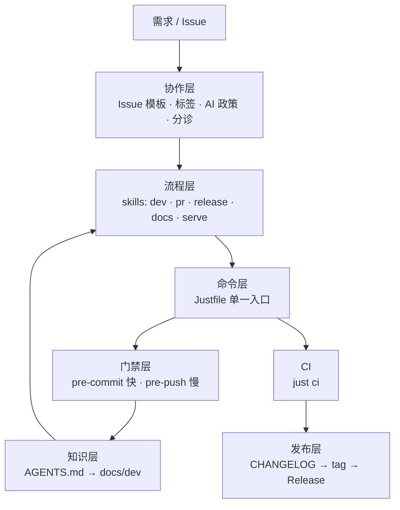

# 项目管理体系：分析与可复用模板

> 分析对象：Amane 仓库（截至 2026-10）。
> 目的不是复制具体命令，而是抽出可迁移的结构、判据与踩坑。模板位于 `templates/`，替换占位符后可直接落到新仓库。

## 1. 这套体系解决什么问题

多数仓库的协作成本不在写代码，而在三处漂移：

| 漂移 | 表现 | 后果 |
|------|------|------|
| 命令漂移 | 本地一套、pre-commit 一套、CI 再抄一套 | 本地绿、CI 红；修一次要改三处 |
| 规则漂移 | 规范只在维护者脑中或聊天记录里 | 人和 Agent 各自理解，review 反复解释同一件事 |
| 责任漂移 | AI 生成 Issue / PR / 代码，无人真正审阅 | 维护者变成 AI 输出的验证服务 |

Amane 的解法可以压缩成一句话：

> **把规则写成 Agent 可读的文件，把能自动化的规则压成单一入口，把不能自动化的判断留给人。**

三个关键词对应三层约束：

- **单一入口**：所有检查都能用一条命令复现，CI 不另写步骤。
- **约束外置**：规范落盘为 `AGENTS.md`、`docs/dev/`、skill、hook，而不是口口相传。
- **人在回路**：自动化只做可枚举的判断；批准、合并、发版仍由人触发。

## 2. 总体结构

| 层 | 载体 | 负责什么 |
|----|------|----------|
| 协作层 | Issue 模板、标签、`AI_POLICY.md`、分诊工作流 | 收口输入、标注类型与优先级、约束 AI 使用 |
| 流程层 | `skills/*/SKILL.md` | 规定顺序、边界、禁止事项 |
| 命令层 | `Justfile` | 唯一的任务入口，本地与 CI 共用 |
| 门禁层 | `.pre-commit-config.yaml` + `scripts/githooks/` | 提交前快速修复，推送前完整检查 |
| CI | `.github/workflows/ci.yaml` | 调用同一条 `just ci`，只补 OS 差异 |
| 知识层 | `AGENTS.md`、`docs/dev/*` | 用最少阅读把 Agent 送到具体文件 |
| 发布层 | `scripts/bump_version.py`、`CHANGELOG.md`、tag 工作流 | 版本、变更说明、制品三者对齐 |
| 并行层 | `git worktree` + `scripts/worktree_setup.py` | 多任务隔离，主检出只读 |

## 3. 逐层实现

### 3.1 命令层：单一入口

`Justfile` 是唯一对外任务入口，根 `package.json` 不承担编排。

关键设计：

- CI 不重写步骤，直接运行 `just ci`；`ci` 展开为 `ci-sync → 生成物漂移检查 → check → build`。本地跑 `just check` 与 CI 的检查内容同源。
- Windows job 只跑 `just ci-windows`（Python 测试）。前端、lint、类型检查与 OS 无关，已在 Ubuntu 覆盖；重复跑只会增加等待。
- 生成物不作为手工维护对象：`_check-openapi` 先重新生成，再 `git diff --exit-code` 检查漂移。漂移即失败，避免生成物与源码不一致。
- 检查目录必须等于 formatter 实际扫描范围。ruff 会格式化 `docs/` 下 md 的代码块；只查 `src/ tests/ scripts/` 会让 `just lint` 绿而全仓格式化产生大量无关改动。Amane 用 `CHECK_DIRS` 一次定义并复用于 lint / fix。
- recipe 同时兼容 `sh` 与 `pwsh`，不在 recipe 内嵌 bash 脚本；Windows 侧由 `[windows]` 指定 `pwsh`。

**可迁移判据**：如果一条检查无法用仓库内一条命令复现，它就不该只存在于 CI 配置里。

### 3.2 知识层：文档是索引，不是百科

`AGENTS.md` 被硬性限制在 200 行以内，只做路由：项目定位、远程操作审批、知识库位置、开发命令、少量不可协商的规范。细节全部下沉到 `docs/dev/`。

`docs/dev/index.md` 是树根，每篇文档主题集中。内容归属按**影响半径**决定：

| 信息 | 归属 |
|------|------|
| 源码本身已说明的事实（字段、签名、枚举、默认值、目录树、命令用法） | 都不写 |
| 单个文件内部的实现原因与约束 | 该文件注释 / docstring |
| 跨模块的边界、顺序、契约、取舍、仍生效的禁止事项 | `docs/dev/` |

判据是：**删掉这条信息，Agent 会不会因此多读文件或读错文件？不会就删。**

配套两份按需查阅的标准：

- `writing.md`：语体、动词、禁止比喻与字面英译。统一所有注释、文档、提交说明、PR 文本。
- `terms.md`：同一概念在开发中文与用户中文里的定名，以及易歧义词的义项分工。

**可迁移判据**：给 Agent 的文档，价值等于它替 Agent 省下的源码阅读量。长文档不是资产，是上下文成本。

### 3.3 流程层：把 SOP 写成 skill

Amane 把重复出现的流程写成 `skills/*/SKILL.md`，每个 skill 只回答三件事：**何时用、按什么顺序、什么绝对不能做**。

| skill | 覆盖的流程 | 关键边界 |
|-------|-----------|----------|
| `amane-dev` | 受理 Issue → 评估 → 方案 → 实现 → 自查 → 验收 → 起草 PR | 未带 `status:triaged` 不得开始实现 |
| `amane-pr` | worktree、分支名、PR 正文、CI 节奏、Issue 关联、合入、堆叠式 PR、Alembic | 推送、合并、回复 Issue 需用户明确批准 |
| `amane-release` | semver 判定 → CHANGELOG → `just bump` → 推 tag | 禁止手改版本、手打 tag、手工建 Release |
| `amane-docs` | 文档与注释的精简、归属判定 | 只覆盖 `docs/dev/` 与源码注释 |
| `amane-serve` | 启动本地服务供用户复核 | 数据准备完成后直接启动，不再询问 |
| `amane-parley` | 双 Agent 批评家 / 主理人轮流评审 | 批评家不得改文件、不得合并 PR |
| `amane-source-research` | 新来源调研的必查项与报告规则 | 逐项报告，不得省略风险 |

设计要点：

- **流程与项目事实分离**。skill 写顺序与判据，具体模块知识留在 `docs/dev/`，避免两处维护。
- **验收有触发条件**。前端样式、用户可见行为、难以用测试验证的改动才要求人工验收；解析器修复由测试证明，不打扰用户。
- **复杂方案先评审**。规模较大时用 `amane-parley` 让第二个 Agent 做批评家，收敛后再实现。
- **远程操作统一审批**。所有 push、PR 更新、Issue 回复都需用户批准，写进 `AGENTS.md` 与 skill。

### 3.4 门禁层：按代价分流

本地钩子用 `prek`（兼容 pre-commit 配置），全部调用 `just` recipe，不重复命令。

分流原则是**按耗时，不按覆盖面**：

| 阶段 | 内容 | 理由 |
|------|------|------|
| pre-commit | 重新生成 API client、ruff 修复/检查、快速类型检查、前端修复/检查 | 秒级反馈，改完即可重新 stage |
| pre-push | 完整类型检查（较慢）、pytest | 一次推送只付一次 |
| CI | 全量 check + coverage + build | 最终门禁 |

其他细节：

- **文件过滤**：只在与钩子相关的文件变化时运行。文档、YAML、Dockerfile 不触发 Python/前端钩子。
- **生成物先跑**：后端源码变化会重新生成 OpenAPI 与 TS client，随后前端检查必须一起跑，否则会出现本地绿、CI 红。
- **`fail_fast: true`**：修复型钩子改了文件就停，后续检查此刻必败，直接要求重新 stage。
- **钩子路径无关**：`just setup` 写入 `core.hooksPath scripts/githooks`，shim 从当前 worktree 或主检出的 `.venv` 定位 `prek`。禁止执行 `prek install`，它会写入安装时检出的绝对路径，该 worktree 删除后其余 worktree 的提交全部失败。

### 3.5 CI 层：只补本地覆盖不到的部分

- 触发分支为 `main` / `develop`；`paths-ignore` 跳过纯文档、LICENSE、`.gitignore`。
- 单一 `check` job 调 `just ci`，与本地完整门禁同构。
- OS 差异单独成 job：Windows 只跑 Python 测试，因为盘符、路径分隔符、跨盘 `commonpath` 等语义只在 Windows 成立。
- **条件 job 不要用工作流级 `paths`**：被设为必需检查的 job 会永远停在 pending。Amane 的做法是先跑一个轻量 `changes` job，用三点 diff 判断是否碰到目标目录，再由 `needs` + `if` 决定是否启动重 job。
- 覆盖率作为 CI 产物上传，不作为通过门槛；玩具测试靠 review 与规范剔除，而不是靠数字。

### 3.6 发布层：三个单一事实源

| 事实 | 唯一手写源 | 派生 |
|------|-----------|------|
| 产品版本 | `pyproject.toml` | `uv.lock`、OpenAPI、TS client |
| 该版本的用户说明 | `CHANGELOG.md` 对应 `##` 节 | GitHub Release 正文 |
| 制品 | git tag `vX.Y.Z` | Docker 镜像、桌面安装包 |

`just bump <kind>` 的内部顺序：

1. `precheck`：工作区干净（仅允许未提交的 `CHANGELOG.md`）、下一版本与当前不同、tag 不存在、对应 CHANGELOG 节非空。
2. `uv version --bump` 修改版本。
3. `just generate` 刷新生成物。
4. 按白名单 `git add` / `commit -m "release: X.Y.Z"` / 打 annotated tag。

白名单是关键：bump 只允许 `CHANGELOG.md`、`pyproject.toml`、`uv.lock`、`web/openapi.json`、`web/src/client/` 变化；出现其它文件立即中止，避免把开发中的改动混进发版提交。

CHANGELOG 规则：

- 分组固定为 `✨ 新功能` / `🐛 修复` / `⚡ 性能` / `⚠️ 破坏性变更`，对应 `feat` / `fix` / `perf` / breaking。
- 同一主题的多条提交合并成一条，不把每条 commit 摊成一行。
- `🐛 修复` 只收**已发布版本中存在**的缺陷；本区间新功能引入的缺陷并入该功能，不单列。
- 条目写用户能看懂的结果，不写实现细节、限定条件、迁移边角。

### 3.7 协作层：收口输入，约束自动化

**Issue 入口**：

- 网页模板是唯一入口，`blank_issues_enabled: false`。
- 模板自带 `kind:*` 标签；无标签的 Issue 由工作流识别为「未走模板」并关闭。原因是 CLI / API 创建 Issue 会绕过模板，而这是 AI Agent 的典型行为。
- `status:triaged` 只能由维护者添加。它表示「已确认有效」，是实现的前置条件。
- 14 天无活动的 `status:needs-info` / `kind:question` 先标 stale，再 7 天关闭。

**AI 政策**（`AI_POLICY.md`）：

- 允许使用 AI，但提交者必须 review、理解并对内容负责。
- Issue / PR 必须披露 AI 使用程度，分三级：部分撰写或润色 / 主要由 AI 撰写 / AI 自动化创建。
- 明确把「让维护者替 AI 输出做人工验证」定义为滥用，维护者可关闭、限制或封禁。
- 判断标准落到可执行的问题上：PR 上投入的人力是否少于 review 它所需的人力。

**分诊 Agent**（GitHub Agentic Workflow）：

- 目标只有两个：挡掉低质量 Issue、让留下的 Issue 便于接手。不实现、不评估工作量、不承诺排期。
- 阅读边界：文档 + 最多一两个源文件；禁止大面积读代码、禁止复现、禁止给实现方案。
- 写操作走 `safe-outputs` 白名单：只能加/删允许列表内的标签、改标题、发一条评论；不关闭 Issue、不改正文。
- `status:triaged` 明确留给人工。
- 预算与轮次有上限（Amane 为 15 AIC / 20 轮 / 10 分钟），防止「调查式」长链调用。
- 判断倾向是**存疑从严**：拿不准是否需要补充信息，就停在 `status:needs-info`，不让不确定性继续下传。

**PR 契约**（写在 `amane-pr` skill）：

- 顺序：Summary → 接口与数据变更 → Implementation → Test plan → Close/Fix 或 Related。
- Summary 是抽象能力清单，每条为无标点单句；禁止源码标识符、调用链描述、实现细节。
- 接口与数据变更用表格；大规模 PR 必写，小修复可省略。
- 只描述最终形态，禁止把开发过程中的增强、返工、重命名写进正文。
- 推 CI 要攒：本地做完、用户确认实现后再推；一轮 CI 只等一次。失败后若需改业务代码，先向用户报告。
- 合入首选 squash；简单 PR 可 rebase；永远不用 merge commit。合并信息即 PR 标题。
- 堆叠式 PR 按依赖分层，`gh stack merge` 原子合入；手工改 base 会导致工作流不触发。
- 带 migration 的 PR 在正文最前加固定警告；多个并行 migration 合并前必须确认 `alembic heads` 只剩一个，不新增 merge revision。

### 3.8 并行层：worktree 隔离

- 每个 PR 用独立 worktree，不在主检出开发。
- `orca.yaml` 在工作树创建后执行 `scripts/worktree_setup.py`：
  - 复制主检出的 `data/`（配置、业务库、会话历史），避免刮削数据与收藏重来；
  - 生成 `.env`，把资源缓存与模型权重指向主检出的共享目录；
  - 运行 `just setup` 同步依赖与钩子。
- 脚本硬约束：不依赖 cwd、不写主检出（主检出只读）、可重复执行（已有文件默认不覆盖）。
- 复制 SQLite 前检查 WAL 是否非空，并做 `PRAGMA quick_check`，避免把半截事务带到新工作区。

### 3.9 质量层：测试与类型

- **测试分层**：语义在哪一层实现，就在哪一层测。HTTP 集成必须存在，但不重复覆盖 repo / 纯函数已经覆盖的表。
- **禁止玩具测试**：默认值回声、实现复述、mock 回声、只断言非空、常量快照、写入再回读，全部删除。覆盖率是副产品，不是目标。
- **必须覆盖**：校验拒绝与报错信息、旧字段 / 迁移、数据库真正强制的唯一与检查约束、解析分类的边界与非法输入、冻结的对外表面。
- **类型规范**：完备类型标注；禁止内部导入、反射、全局变量；TypeScript 禁止 `as` 断言与 `any`。
- **计划层**：`docs/roadmap.md` 用 checklist 记录未完成项；需求完成后移除对应条目，避免 roadmap 变成历史档案。

## 4. 可迁移的设计原则

| 原则 | Amane 的实现 | 效果 |
|------|--------------|------|
| 单一入口 | `Justfile` + CI 调 `just ci` | 本地与 CI 同构，改一处生效 |
| 规则可执行 | hook、脚本、模板 | 不依赖自觉与记忆 |
| 按代价分流 | commit 快 / push 慢 / CI 全量 | 反馈快，重复成本低 |
| 生成物先于检查 | 重新生成 → diff → 检查 | 消除本地绿、CI 红 |
| 单一事实源 | 版本、CHANGELOG、API 各只有一个手写源 | 无手抄漂移 |
| 文档即索引 | `AGENTS.md` ≤ 200 行，`docs/dev/` 树状 | 省上下文 |
| 受控自主 | 分诊 Agent 的标签白名单、阅读边界、预算上限 | 自动化可控、可审计 |
| 人在回路 | `status:triaged`、远程操作审批、AI 披露 | 责任明确 |
| 隔离并行 | worktree + setup 脚本 | 任务互不污染 |

## 5. 迁移到其他项目

### 5.1 分阶段落地

**阶段一：最小闭环**（收益最大，成本最低）

1. `AGENTS.md`：项目定位、命令、远程操作审批、知识库位置；同时建立 `<DOCS_DIR>/index.md`、
   `writing.md`、`terms.md` 三个骨架。
2. `Justfile`：`setup` / `lint` / `fix` / `typecheck` / `test` / `check` / `ci`。
3. 钩子：pre-commit 修复 + 快速检查，pre-push 完整检查。
4. CI：一个 job 运行 `just ci`，不再重写步骤。

**阶段二：协作规范**

5. `AI_POLICY.md` 与 Issue 模板（Bug / Feature / Proposal）。
6. PR 正文契约：Summary、接口变更、Implementation、Test plan、Issue 关联。
7. 发布管线：semver 判定 + CHANGELOG 单一源 + `just bump` + tag 触发制品。
8. 测试与类型规范写入 `docs/dev/testing.md` 与 `AGENTS.md`。

**阶段三：自动化与并行**

9. skill 化重复流程（开发、PR、发布、文档）。
10. worktree 一键 setup。
11. Issue 分诊 Agent（先只读试运行，再开放写标签）。
12. 堆叠式 PR、迁移 multi-head 处理等复杂场景规范。

顺序的理由：**先稳定命令面，再统一规则，最后自动化判断**。命令面未定时就上自动化，规则会随命令反复重写。

### 5.2 占位符

模板统一使用以下占位符：

| 占位符 | 含义 | 示例 |
|--------|------|------|
| `<PROJECT>` | 项目名 | `amane` |
| `<SRC>` / `<TESTS>` / `<SCRIPTS>` | 源码 / 测试 / 脚本目录 | `src/app` / `tests` / `scripts` |
| `<DOCS_DIR>` | Agent 文档目录 | `docs/dev` |
| `<LANGUAGE>` / `<FRONTEND>` | 主要语言 / 前端技术栈 | `Python` / `TypeScript` |
| `<BRANCH>` | 主分支 | `main` |
| `<repo>` / `<type>` / `<topic>` | worktree 与分支命名 | `<repo>-login` / `feat` / `login` |

Justfile 不直接使用上述占位符, 而是在文件顶部集中定义 `SRC` / `TESTS` / `SYNC` / `LINT` / `TEST` 等变量,
替换一次即可.

### 5.3 不要照搬的部分

- **Issue 无标签自动关闭**：Amane 用它挡 AI 生成的 Issue。若社区以 CLI 提交流为主，这会误伤；可改为「要求补充信息」而非直接关闭。
- **`paths-ignore` 跳过文档**：若文档站构建本身是门禁，应单独保留 `docs` 工作流，不能一并跳过。
- **单 CI job**：并行度高的大仓可以拆分，但拆分后仍应让每个 job 调用 `just` 子命令，而不是复制步骤。
- **前端钩子与 CI 步骤**：没有前端时删掉 `fix-web` / `check-web`、CI 里的 pnpm / Node 步骤与 `web/` 缓存路径，不要留下空钩子。
- **发布脚本**：`release.py` 依赖 `uv version`、`pyproject.toml` 与固定白名单，换语言栈时需要替换版本读写与白名单，但「预检 → 升版本 → 生成 → 白名单提交 → 打 tag」的顺序可保留。

## 6. 模板索引

| 模板 | 用途 | 复制到 |
|------|------|--------|
| `templates/AGENTS.md` | Agent 总入口 | 仓库根 `AGENTS.md` |
| `templates/AI_POLICY.md` | AI 使用与披露政策 | 仓库根 `AI_POLICY.md` |
| `templates/docs/index.md` | 知识库树根与阅读顺序 | `<DOCS_DIR>/index.md` |
| `templates/docs/writing.md` | 语体、动词、禁止比喻 | `<DOCS_DIR>/writing.md` |
| `templates/docs/terms.md` | 概念定名与义项分工 | `<DOCS_DIR>/terms.md` |
| `templates/PR.md` | PR 正文契约与合入规范 | `docs/dev/pr.md` 或 skill |
| `templates/CHANGELOG.md` | 变更说明格式 | 仓库根 `CHANGELOG.md` |
| `templates/Justfile` | 命令入口骨架 | 仓库根 `Justfile` |
| `templates/scripts/release.py` | 发版预检、白名单提交、CHANGELOG 抽取 | `scripts/release.py` |
| `templates/pre-commit-config.yaml` | 提交 / 推送门禁 | 仓库根 `.pre-commit-config.yaml` |
| `templates/githooks/pre-commit` | 路径无关的提交钩子 shim | `scripts/githooks/pre-commit` |
| `templates/githooks/pre-push` | 路径无关的推送钩子 shim | `scripts/githooks/pre-push` |
| `templates/workflows/ci.yaml` | 主 CI | `.github/workflows/ci.yaml` |
| `templates/workflows/issues.yml` | 无模板 Issue 关闭 + stale | `.github/workflows/issues.yml` |
| `templates/ISSUE_TEMPLATE/bug_report.yml` | Bug 模板 | `.github/ISSUE_TEMPLATE/` |
| `templates/ISSUE_TEMPLATE/feature_request.yml` | 功能请求模板 | `.github/ISSUE_TEMPLATE/` |
| `templates/ISSUE_TEMPLATE/proposal.yml` | 协作者的计划记录模板 | `.github/ISSUE_TEMPLATE/` |
| `templates/ISSUE_TEMPLATE/config.yml` | 禁用空白 Issue | `.github/ISSUE_TEMPLATE/` |
| `templates/skills/dev/SKILL.md` | 开发流程 | `skills/dev/SKILL.md` |
| `templates/skills/pr/SKILL.md` | PR 流程 | `skills/pr/SKILL.md` |
| `templates/skills/release/SKILL.md` | 发版流程 | `skills/release/SKILL.md` |

## 7. 维护这套体系

- **命令**：新增检查先加 `just` recipe，再让 hook 或 CI 调用；禁止在别处复制命令。
- **规则**：改流程时同步对应 skill；项目事实改在 `docs/dev/`，不要写进 skill。
- **文档**：每次改动顺手压缩所在段落；删除文档时同步删除索引与引用。
- **钩子**：删除长期无人触发的钩子；钩子越多，提交越慢，绕过动机越强。
- **发布**：发版后回看 CHANGELOG 是否像用户说明，而不是 commit 列表。
- **自动化**：分诊 Agent 每次调整标签或预算后，抽样检查误判与漏判，再扩大权限。
